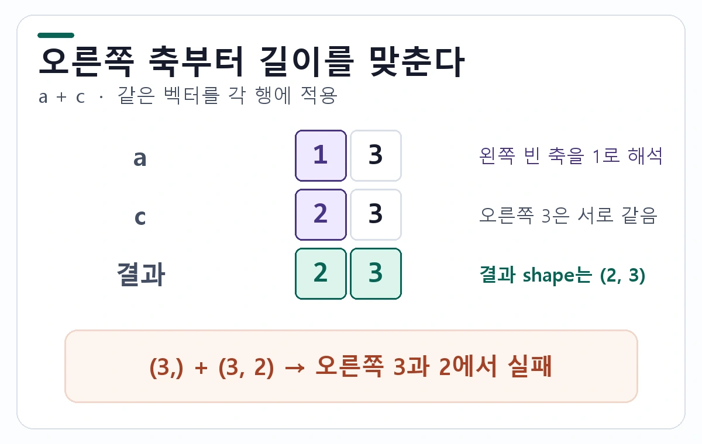
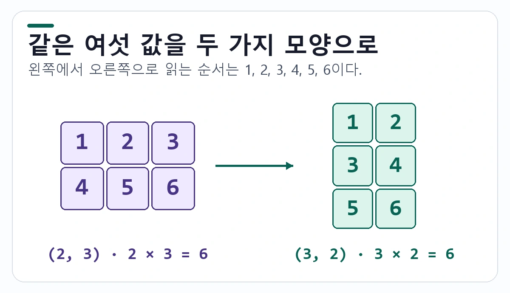

`[1, 2, 3]`을 두 행에 더하면 각 행의 세 값이 차례로 더해진다. 같은 숫자 여섯 개를 세 행 두 열로 다시 배치하면 덧셈에서 `ValueError`가 난다.

```python
import numpy as np

a = np.array([1, 2, 3])
c = np.array([[1, 2, 3], [4, 5, 6]])

print(a + c)
try:
    a + c.reshape(3, 2)
except ValueError as error:
    print(f"ValueError: {error}".rstrip())
```

```output
[[2 4 6]
 [5 7 9]]
ValueError: operands could not be broadcast together with shapes (3,) (3,2)
```

`reshape(3, 2)`는 이 예제에서 값의 순서를 유지하면서 행과 열의 개수를 바꾼다. 오류 메시지의 `(3,)`과 `(3,2)`는 덧셈에 넘긴 두 배열의 `shape`다. 먼저 배열의 `+`가 무엇을 더하는지 살펴보고, 그다음 메시지에서 서로 맞지 않는 축을 찾아본다. `try`와 `except`는 오류 메시지를 보여 주고 예제를 끝내기 위한 부분이다.

## 같은 위치의 두 원소에 사칙연산을 적용한다

`[1, 2, 3]`과 `[4, 5, 6]`을 리스트로 더하면 숫자 여섯 개가 한 줄로 이어진다. 두 리스트를 같은 모양의 NumPy 배열로 바꿔 더하면 첫 칸끼리, 둘째 칸끼리, 셋째 칸끼리 짝을 짓는다. 결과에는 세 칸이 남는다. 이렇게 각 위치에 같은 계산을 적용하는 방식을 **원소별 연산**이라고 한다.

```python
import numpy as np

left = [1, 2, 3]
right = [4, 5, 6]
a = np.array(left)
b = np.array(right)

print(left + right)
print(a + b)
print(a - b)
print(a * b)
print(a / b)
print(a // b)
print(a % b)
```

```output
[1, 2, 3, 4, 5, 6]
[5 7 9]
[-3 -3 -3]
[ 4 10 18]
[0.25 0.4  0.5 ]
[0 0 0]
[1 2 3]
```

이 예제에서 두 번째 칸은 `a`의 `2`와 `b`의 `5`가 만나는 자리다. `2 + 5`는 `7`, `2 - 5`는 `-3`, `2 * 5`는 `10`이다. 같은 짝으로 `2 / 5`를 하면 `0.4`, `2 // 5`를 하면 `0`, `2 % 5`를 하면 `2`다. 사칙연산에서 어떤 기호를 쓰든 먼저 대응하는 두 칸을 찾으면 된다. `*`의 세 결과가 배열에 각자 남는다는 점은 4편의 행렬곱과 비교할 때 다시 쓴다.

나눗셈 기호 세 개는 작은 예로 차이를 확인할 수 있다. `7`을 `4`로 나누면 `/`는 `1.75`를 구한다. `//`는 몫을 `1`로 내리고, `%`는 그 몫을 기준으로 남은 `3`을 구한다. 그래서 `7 = 4 × 1 + 3`이다. `//`로 내린다는 말은 수직선에서 값이 작아지는 방향을 뜻한다. `-7 / 4`가 `-1.75`이면 그보다 작거나 같은 가장 가까운 정수는 `-2`고, `-7 = 4 × (-2) + 1`이므로 나머지는 `1`이다. [NumPy 내림 나눗셈](https://numpy.org/doc/2.4/reference/generated/numpy.floor_divide.html) · [NumPy 나머지](https://numpy.org/doc/2.4/reference/generated/numpy.remainder.html)

```python
import numpy as np

values = np.array([7, -7])
print(values / 4)
print(values // 4)
print(values % 4)
```

```output
[ 1.75 -1.75]
[ 1 -2]
[3 1]
```

이번에는 오른쪽에 숫자 `4` 하나만 있었지만 왼쪽의 `7`과 `-7`이 각각 `4`와 짝을 이뤘다. 숫자 하나를 더할 때도 같은 방식으로 짝을 만든다. 예를 들어 `a + 1`의 세 칸은 각각 `1 + 1`, `2 + 1`, `3 + 1`이다. 한 값을 여러 칸에 적용하는 이 규칙을 축 길이가 다른 두 배열에도 쓸 수 있다.

## 같은 표에서도 행과 열에 더하는 배열의 모양이 다르다

**브로드캐스팅**은 두 배열의 모양이 다를 때, 어떤 값끼리 짝지어 계산할 수 있는지 정하는 규칙이다. 두 `shape`를 오른쪽부터 나란히 맞춘다. 한쪽에 축이 부족하면 비어 있는 왼쪽 자리를 길이 `1`로 본다. 같은 위치의 두 길이가 같으면 한 칸씩 대응한다. 길이 `1`인 쪽에는 값이 한 칸뿐이므로 그 값을 다른 쪽의 해당 축에 공통으로 적용한다.



그림에서 `(3,) + (2, 3)`을 비교할 때는 오른쪽의 `3`이 먼저 맞는다. 왼쪽은 `1`과 `2`이므로 세 값의 조합을 표의 두 행에 각각 적용한다. `(3,) + (3, 2)`는 오른쪽의 `3`과 `2`에서 막힌다. 그림에 끼워 넣은 왼쪽 `1`은 축을 비교하기 위한 표시다. 설명에서는 값을 여러 칸에 놓은 것처럼 그려도, NumPy는 이 연산을 위해 입력을 새 표로 복제할 필요가 없다. [NumPy 브로드캐스팅 규칙](https://numpy.org/doc/2.4/user/basics.broadcasting.html#general-broadcasting-rules)

이제 같은 `2행 3열` 표에 두 가지 규칙으로 숫자를 더해 보자. **열마다** `10`, `20`, `30`을 더하려면 필요한 값이 세 개다. 오른쪽 축의 길이가 `3`이므로 길이 `3`인 배열을 그대로 더한다. 첫 행의 가운데 칸은 `2 + 20`이고, 둘째 행의 가운데 칸은 `5 + 20`이다.

**행마다** `100`, `200`을 더하려면 필요한 값이 두 개다. 그대로 더한 `c + rows`는 표의 열이 세 개라서 실패한다. NumPy는 `(2,)`의 `2`를 오른쪽인 열 축에 맞춘다. `rows.reshape(2, 1)`로 바꾸면 왼쪽의 `2`가 표의 두 행과 만나고, 오른쪽의 `1`은 행마다 정해진 값을 세 열에 적용한다. 첫 행의 세 칸에는 모두 `100`을 더한다.

```python
import numpy as np

c = np.array([[1, 2, 3], [4, 5, 6]])
columns = np.array([10, 20, 30])
rows = np.array([100, 200])

print(c + columns)
try:
    print(c + rows)
except ValueError as error:
    print(f"ValueError: {error}".rstrip())
print(c + rows.reshape(2, 1))
```

```output
[[11 22 33]
 [14 25 36]]
ValueError: operands could not be broadcast together with shapes (2,3) (2,)
[[101 102 103]
 [204 205 206]]
```

`try`와 `except`를 두면 가운데 연산의 오류 메시지를 보고 다음 줄에서 수정한 덧셈까지 실행할 수 있다. 메시지의 `(2,3)`은 표의 모양이고 `(2,)`는 행에 배정할 두 값의 모양이다. 오른쪽에서 처음 마주치는 `3`과 `2`는 둘 다 `1`이 아니어서 짝을 만들 수 없다. 어떤 축에 값을 배정하려는지 먼저 정하면 어느 쪽에 길이 `1`을 둘지 결정할 수 있다.

| 하고 싶은 계산 | 오른쪽에 더할 배열 | `shape`를 맞춘 뒤의 대응 |
|---|---|---|
| 열마다 `10`, `20`, `30`을 더한다 | `(3,)` | 열마다 값 하나가 정해지고 모든 행에 적용된다. |
| 행마다 `100`, `200`을 더한다 | `(2, 1)` | 행마다 값 하나가 정해지고 해당 행의 모든 열에 적용된다. |
| 행에 더할 값과 열에 더할 값의 합을 모두 구한다 | `(2, 1)`과 `(1, 3)` | 한쪽에서는 열, 다른 쪽에서는 행이 늘어나 `(2, 3)`이 된다. |

도입에서 덧셈에 실패한 `(3,) + (3, 2)`도 같은 원리로 읽을 수 있다. `1`, `2`, `3`을 **세 행에 하나씩** 배정하려면 `a.reshape(3, 1) + c.reshape(3, 2)`로 계산한다. 두 행이던 표를 `[[1, 2], [3, 4], [5, 6]]`으로 배치하고, 각 행의 두 칸에 `1`, `2`, `3`을 차례로 더하면 `[[2, 3], [5, 6], [8, 9]]`가 된다. `(3, 1)`에서 오른쪽 `1`은 열에 공통으로 적용한다는 뜻이고, 왼쪽 `3`은 더할 표의 행 길이와 맞아야 한다. 그래서 `(3, 1) + (2, 3)`은 오른쪽의 `1`과 `3`은 맞지만 왼쪽의 `3`과 `2`에서 실패한다.

**직접 확인해 보기.** 표 `c` 없이 `rows.reshape(2, 1) + columns.reshape(1, 3)`을 계산해 보자. 첫 행에서는 `100`에 `10`, `20`, `30`을 하나씩 더한다. 둘째 행에서는 `200`에 같은 세 값을 더한다. 첫 행은 `[110, 120, 130]`이고 둘째 행은 `[210, 220, 230]`이다. 각 칸이 어느 두 값의 합인지 확인하면, 두 배열이 각각 어느 축에 적용됐는지 확인할 수 있다.

3차원 배열에서도 오른쪽부터 같은 순서로 비교한다. 2편의 `t`를 `np.arange(24).reshape(2, 3, 4)`로 다시 만든다. `t + np.array([0, 10, 20, 30])`에서는 길이 `4`가 열에 대응한다. 표 두 장의 모든 행에 같은 열별 값을 더하므로 결과 모양은 `(2, 3, 4)`다. 첫 표의 첫 행 `[0, 1, 2, 3]`은 `[0, 11, 22, 33]`으로 바뀐다.

## `reshape`는 읽는 순서로 묶고 전치는 축을 교환한다

숫자 `1`부터 `12`까지를 같은 순서로 읽으면서 새 표를 만든다고 해 보자. `reshape(2, 6)`은 여섯 값씩 두 줄에 담는다. `reshape(3, -1)`에서 `-1`은 한 축의 길이를 NumPy가 계산하라는 뜻이다. 행이 세 개고 원소가 열두 개이므로 한 행에 `12 ÷ 3 = 4`개씩 들어간다. 이처럼 같은 숫자로 새 모양을 만들 때는 모든 축의 길이를 곱한 값이 원래 `size`와 맞아야 한다.

```python
import numpy as np

numbers = np.arange(1, 13)
print(numbers.reshape(3, -1))
print(numbers.reshape(2, 6))
try:
    print(numbers.reshape(5, 3))
except ValueError as error:
    print(f"ValueError: {error}".rstrip())
```

```output
[[ 1  2  3  4]
 [ 5  6  7  8]
 [ 9 10 11 12]]
[[ 1  2  3  4  5  6]
 [ 7  8  9 10 11 12]]
ValueError: cannot reshape array of size 12 into shape (5,3)
```

`(5, 3)`에는 열다섯 칸이 필요하다. `size 12`를 알려 주는 위 오류는 모양을 바꾸는 단계에서 생겼다. 반면 `(2, 3) + (2,)`의 오류는 이미 만들어진 두 배열이 연산에서 축을 맞추지 못한 경우다. 오류에 `size`와 새 모양이 나오는지, 더하려던 두 배열의 모양이 나오는지 읽어 보면 어느 단계에서 막혔는지 알 수 있다. [NumPy `reshape`](https://numpy.org/doc/2.4/reference/generated/numpy.reshape.html)



그림처럼 `c.reshape(3, 2)`는 `1`부터 차례로 읽어 두 값씩 묶는다. **전치**인 `c.T` 또는 `c.transpose()`는 2차원 표의 행과 열을 교환한다. 원래 첫 열 `[1, 4]`가 전치한 표의 첫 행이 된다. 두 동작 모두 아래 예제에서는 `(3, 2)`를 만들지만, 첫 행이 `[1, 2]`인지 `[1, 4]`인지를 보면 어떤 동작을 썼는지 알 수 있다.

```python
import numpy as np

c = np.array([[1, 2, 3], [4, 5, 6]])
print(c.reshape(3, 2))
print(c.T)

v = np.array([1, 2, 3])
print(v.T.shape, v.reshape(-1, 1).shape)
```

```output
[[1 2]
 [3 4]
 [5 6]]
[[1 4]
 [2 5]
 [3 6]]
(3,) (3, 1)
```

마지막 줄에서는 1차원 배열을 전치했다. `(3,)`에는 축이 하나뿐이어서 `v.T.shape`도 `(3,)`이다. 브로드캐스팅에서 세 값을 **세 행에 하나씩** 배정하고 싶다면 `v.reshape(-1, 1)`로 모양을 `(3, 1)`로 만든다. 길이 `1`인 열 축이 생겨야 각 행에 배정한 값을 그 행의 모든 열에 적용할 수 있다.

**직접 확인해 보기.** 2편의 `t`에서 표 두 장의 순서는 두고 표 안의 행과 열만 바꾸면, 축 순서를 `(0, 2, 1)`로 지정한다. `t.transpose(0, 2, 1)`의 모양은 `(2, 4, 3)`이다. 원래 `t[1, 0, 2]`에 있던 `14`는 두 번째 표에 그대로 남고, 행과 열 번호만 바뀌어 새 배열의 `[1, 2, 0]`으로 간다. `t.T`는 세 축을 역순으로 놓아 모양이 `(4, 3, 2)`가 되므로, 표 축을 유지하려면 필요한 순서를 직접 적는다. [NumPy `transpose`](https://numpy.org/doc/2.4/reference/generated/numpy.transpose.html)
