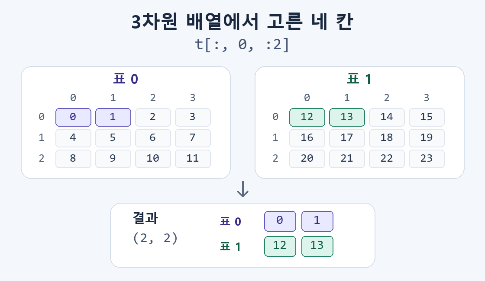

## 같은 열을 골라도 결과의 모양은 달라진다

1편에서 숫자 1부터 6까지를 2행 3열 배열에 담았다. 이 배열의 두 번째 열에 있는 값은 `2`와 `5`다. 아래 코드는 그 두 값을 고르는 표현 두 가지의 결과를 비교하는 예시다. [NumPy 1편](/blog/python-numpy/)

```python
import numpy as np

grid = np.array([[1, 2, 3], [4, 5, 6]])
column_values = grid[:, 1]
column_array = grid[:, 1:2]

print(column_values, column_values.shape)
print(column_array, column_array.shape)
```

```output
[2 5] (2,)
[[2]
 [5]] (2, 1)
```

이렇게 배열에서 값을 고르는 일을 **인덱싱**이라고 한다. 2차원 배열에서는 쉼표 앞에 행, 뒤에 열을 고르는 표현을 쓴다. 두 코드 모두 행 자리에 쓴 `:`로 모든 행을 고른다. 열 번호는 `0`부터 세므로 두 번째 열의 번호는 `1`이다.

`grid[:, 1]`처럼 열 번호 하나를 정수로 지정하면 열 축이 결과에서 빠진다. 결과는 길이가 `2`인 1차원 배열이다. `grid[:, 1:2]`는 `1`번 열부터 `2`번 열 직전까지 범위로 고른다. 열 하나만 고르더라도 열 축은 길이 `1`로 남아 결과가 2행 1열이 된다.

## 위치 하나와 범위를 지정하는 방법이 다르다

배열에서 값의 위치를 나타내는 번호를 **인덱스**라고 한다. 1차원 배열의 첫 위치는 `0`이고, `a[0]`처럼 정수 인덱스 하나를 넣으면 그 자리의 값을 꺼낸다. 배열의 일부를 `시작:끝`으로 고르는 방법은 **슬라이싱**이라고 한다. 아래 코드는 첫 값을 꺼낼 때와 첫 칸을 범위로 고를 때의 차이를 비교하는 예시다.

```python
import numpy as np

a = np.array([1, 2, 3, 4, 5, 6])

print(a[0])
print(a[:1], a[:1].shape)
print(a[1:3])
```

```output
1
[1] (1,)
[2 3]
```

`a[0]`의 결과는 값 `1`이다. `a[:1]`은 시작 위치를 생략한 범위다. 처음부터 인덱스 `1` 직전까지 골라 값 하나를 담은 배열 `[1]`을 돌려준다. `a[1:3]`은 인덱스 `1`에서 시작해 `3` 직전에서 멈추므로 `2`와 `3`을 고른다. [NumPy 인덱싱과 슬라이싱](https://numpy.org/doc/2.4/user/basics.indexing.html#slicing-and-striding)

## 3차원 배열에서는 고른 뒤 남는 축을 읽는다

`(2, 3, 4)` 모양의 배열을 3행 4열짜리 표 두 장으로 읽을 수 있다. `t[:, 0, :2]`는 표·행·열 순서로 대괄호를 읽는다. 첫 번째 `:`는 표 두 장을 모두 고른다. 가운데 `0`은 각 표의 첫 행을, 마지막 `:2`는 그 행의 앞 두 열을 고른다.



아래 코드는 `0`부터 `23`까지를 표 두 장에 순서대로 담고, 두 표에서 같은 네 칸을 고르면서 행 축이 남는지 비교하는 예시다.

```python
import numpy as np

t = np.arange(24).reshape(2, 3, 4)
selected = t[:, 0, :2]
kept_rows = t[:, 0:1, :2]

print(selected, selected.shape, sep="\n")
print(kept_rows, kept_rows.shape, sep="\n")
```

```output
[[ 0  1]
 [12 13]]
(2, 2)
[[[ 0  1]]

 [[12 13]]]
(2, 1, 2)
```

가운데에 정수 `0`을 쓴 결과는 그림과 같다. 행 축이 빠져 남은 축은 표와 열이고, 각 표에서 고른 값이 출력의 한 줄을 이룬다. 가운데에 `0:1`을 쓰면 첫 행을 길이 `1`인 범위로 골라 행 축을 유지한다. 그래서 `(2, 1, 2)`는 표 두 장에 각각 1행 2열이 있다는 뜻이다. [NumPy 인덱싱과 슬라이싱](https://numpy.org/doc/2.4/user/basics.indexing.html#slicing-and-striding)

## 마스크의 참 하나가 점수 한 칸 또는 학생 한 행을 고른다

점수가 `50`을 넘는지 각각 확인하면, 점수마다 `True` 또는 `False`를 하나씩 얻는다. 이 참·거짓 배열을 **마스크**라고 한다. 그림에서 `55`는 조건을 만족해 남고, `42`는 조건을 만족하지 않아 건너뛴다.


학생 한 명의 점수를 한 행에 담은 표에서는 조건을 어느 단위에 적용하는지 먼저 정한다. 아래 코드는 모든 칸에서 80점 이상인 점수를 모으는 경우와 첫 과목이 70점 이상인 학생의 행을 고르는 경우를 비교하는 예시다.

```python
import numpy as np

scores = np.array([[72, 88, 64, 90], [55, 67, 81, 70], [91, 74, 82, 96]])
cell_mask = scores >= 80
row_mask = scores[:, 0] >= 70

print(cell_mask)
print(scores[cell_mask], scores[cell_mask].shape)
print(row_mask)
print(scores[row_mask], scores[row_mask].shape)
```

```output
[[False  True False  True]
 [False False  True False]
 [ True False  True  True]]
[88 90 81 91 82 96] (6,)
[ True False  True]
[[72 88 64 90]
 [91 74 82 96]] (2, 4)
```

`cell_mask`의 모양은 점수표와 같은 `(3, 4)`다. `True` 하나가 점수 한 칸을 가리키므로 참인 위치의 점수 여섯 개가 1차원 배열에 차례로 들어간다. `row_mask`는 첫 과목 점수 `[72 55 91]`에서 만들었으므로 모양이 `(3,)`이다. `True` 하나가 학생 한 명을 가리키므로 첫 번째와 세 번째 학생의 행이 남는다. 각 행의 과목 점수 네 개도 그대로라 결과의 모양은 `(2, 4)`다. [NumPy 불리언 인덱싱](https://numpy.org/doc/2.4/user/basics.indexing.html#boolean-array-indexing)

**직접 확인해 보기.** `row_mask`의 기준을 `70`에서 `90`으로 바꾼다. 첫 과목이 91점인 세 번째 학생만 남는다. 결과는 과목 네 개를 담은 한 행이므로 `shape`는 `(1, 4)`다.

이번 편에서는 값을 고른 뒤 남는 축을 읽었다. 

[NumPy 3편](/blog/python-numpy-broadcasting/)에서는 두 배열의 축별 길이가 계산에서 어떻게 맞춰지는지 살펴본다.