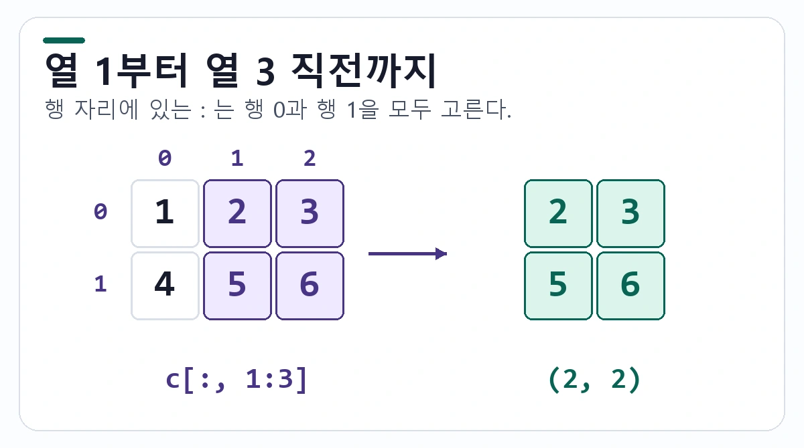
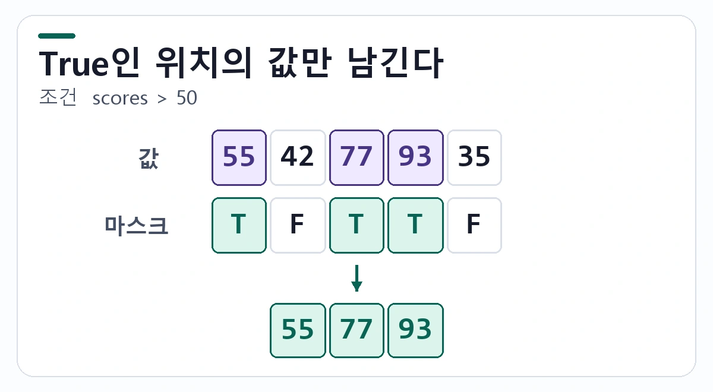

[NumPy 1편](/blog/python-numpy/)에서는 배열을 만들고 `shape`로 각 축의 길이를 읽었다. 2차원 배열에서 행과 열이 무엇을 나타내는지 알면, 필요한 값이 어디에 있는지도 찾을 수 있다.

예를 들어 과목별 점수를 담은 배열에서 행은 학생, 열은 과목을 나타낸다. 한 학생의 첫 과목 점수는 그 학생의 행과 첫 번째 열이 만나는 칸에 있다. 모든 학생의 첫 과목 점수는 첫 번째 열 전체에 있고, 80점 이상인 점수는 표 전체에서 조건을 만족하는 칸에 있다. 이렇게 위치나 조건으로 배열에서 값을 고르는 일을 **인덱싱**이라고 한다.

## 첫 번째 값의 인덱스는 0이다

인덱스는 값의 위치를 나타내는 번호다. 첫 번째 값의 위치는 `0`이다. 배열의 일부를 범위로 고르는 방법을 슬라이싱이라고 한다. `시작:끝`으로 적으면 시작 위치부터 끝 위치 직전까지 고른다. 아래 코드는 `a[0]`으로 첫 값을, `a[0:2]`로 처음 두 값을 꺼내는 예시다.

```python
import numpy as np

a = np.array([1, 2, 3])
print(a[0])
print(a[0:2])
```

```output
1
[1 2]
```

뒤에서 세면 마지막 위치가 `-1`이고, 그 앞은 `-2`다. 범위를 고를 때는 양끝을 생략하거나 세 번째 자리에 건너뛸 간격을 쓸 수 있다. `a[:3]`은 맨 처음부터 인덱스 `3` 직전까지, `a[3:]`은 인덱스 `3`부터 마지막까지 고른다. `a[::2]`는 맨 처음부터 두 칸 간격으로 고른다.

```python
import numpy as np

a = np.array([10, 20, 30, 40, 50])
print(a[-1])
print(a[:3])
print(a[3:])
print(a[::2])
```

```output
50
[10 20 30]
[40 50]
[10 30 50]
```

`a[::2]`가 고르는 위치는 `0`, `2`, `4`다. 그 자리의 값을 차례대로 읽으면 `10`, `30`, `50`이다. `a[0]`은 숫자 하나를 꺼내고, `a[:1]`은 첫 칸을 담은 길이 `1`의 배열을 돌려준다.

이 배열에서 마지막 위치는 `4`다. `a[5]`는 없는 위치를 지정하므로 `IndexError`가 난다. `a[:5]`는 `5` 직전까지 고르므로 다섯 칸을 모두 담는다. 슬라이스의 끝값이 길이를 넘는 `a[:6]`도 실제로 있는 다섯 칸까지만 담는다.

## 행과 열을 지정해 값과 구간을 꺼낸다

### 한 칸과 열 범위 고르기

2차원 배열 `c`에서 `c[행, 열]`처럼 행과 열에 정수 인덱스를 하나씩 쓰면 한 칸을 고른다. `c[1, 2]`는 두 번째 행의 세 번째 열에 있는 `6`이다.



그림의 보라색 네 칸은 `c[:, 1:3]`으로 고른 범위다. 쉼표 앞의 `:`는 모든 행을, 뒤의 `1:3`은 열 인덱스 `1`과 `2`를 고른다. 행 두 개와 열 두 개가 남아 결과의 `shape`는 `(2, 2)`다.

```python
import numpy as np

c = np.array([[1, 2, 3], [4, 5, 6]])
print(c[1, 2])
print(c[:, 1:3])
```

```output
6
[[2 3]
 [5 6]]
```

### 열 하나를 골라도 모양은 달라진다

`c[0, :]`는 첫 행의 모든 열을 고른다. `c[:, 1]`과 `c[:, 1:2]`는 둘 다 모든 행에서 두 번째 열의 값을 고른다. 정수 `1`로 고르면 열 축이 빠지고, 슬라이스 `1:2`로 고르면 길이가 `1`인 열 축이 남는다.

```python
import numpy as np

c = np.array([[1, 2, 3], [4, 5, 6]])
print(c[0, :])
print(c[:, 1], c[:, 1].shape)
print(c[:, 1:2], c[:, 1:2].shape)
```

```output
[1 2 3]
[2 5] (2,)
[[2]
 [5]] (2, 1)
```

두 식에서 고른 값은 `2`와 `5`로 같다. `c[:, 1:2]`의 출력에서는 각 행 안에 값이 하나씩 표시된다. 열 축을 남겨야 하는 계산에 넘길 때는 이처럼 열을 슬라이스로 고른다.

### 슬라이스의 뷰와 복사본 비교하기

기본 슬라이스는 원래 배열과 데이터를 공유하는 배열을 돌려준다. 이를 뷰(view)라고 한다. `copy()`를 붙이면 선택한 값을 독립된 배열에 복사한다.

```python
import numpy as np

c = np.array([[1, 2, 3], [4, 5, 6]])
column = c[:, 1]
separate = c[:, 1].copy()
column[0] = 20
separate[1] = 50
print(c)
print(separate)
```

```output
[[ 1 20  3]
 [ 4  5  6]]
[ 2 50]
```

`column[0]`에 쓴 `20`은 `c[0, 1]`에도 반영된다. `separate`는 값을 따로 가져왔으므로 `50`을 써도 `c[1, 1]`은 `5`로 남는다. 원본을 유지하면서 잘라 낸 값을 수정하려면 `copy()`로 복사한 배열을 사용한다. [NumPy 슬라이싱과 뷰](https://numpy.org/doc/2.4/user/basics.indexing.html#slicing-and-striding)

## 3차원 배열에서는 표, 행, 열을 차례로 고른다

### 표 한 장에서 값 하나까지 고르기

`shape`가 `(2, 3, 4)`인 배열은 3행 4열짜리 표 두 장으로 읽을 수 있다. `np.arange(24)`로 `0`부터 `23`까지 만든 뒤 `reshape(2, 3, 4)`로 배치하면, `0`부터 `11`까지가 첫 번째 표에, `12`부터 `23`까지가 두 번째 표에 놓인다.

```python
import numpy as np

t = np.arange(24).reshape(2, 3, 4)
print(t.shape)
print(t[0])
print(t[0, 1])
print(t[0, 1, 2])
```

```output
(2, 3, 4)
[[ 0  1  2  3]
 [ 4  5  6  7]
 [ 8  9 10 11]]
[4 5 6 7]
6
```

`t[0, 1, 2]`는 표, 행, 열의 위치를 차례로 읽는다. `t[0]`은 첫 번째 **표**다. 그 안에서 `1`번 **행**을 고르면 `[4 5 6 7]`이 남는다. 이 줄에서 `2`번 **열**은 세 번째 칸이므로 `6`이다. 이 예시처럼 축을 정수 하나로 고르면 해당 축이 결과에서 빠진다. 표 한 장을 고르면 `(3, 4)`, 행까지 고르면 `(4,)`가 되며, 열까지 고르면 숫자 하나가 나온다.

### 같은 값을 고르면서 행 축 유지하기

`t[:, 0, :2]`의 첫 번째 `:`는 표 두 장을 고른다. 가운데 `0`은 각 표에서 첫 행을, 마지막 `:2`는 그 행의 앞 두 칸을 고른다. 그림에서는 표마다 고른 값을 서로 다른 색으로 표시했다.


`0`과 `0:1`을 비교하면, 고른 값이 같아도 축을 남기는 방식이 다르다는 점이 드러난다. 정수 `0`으로 고르면 행 축이 사라져 결과에 표와 열만 남는다. `0:1`은 행을 하나 담은 **범위**라서 행 축의 길이 `1`도 남긴다.

```python
import numpy as np

t = np.arange(24).reshape(2, 3, 4)
selected = t[:, 0, :2]
kept_rows = t[:, 0:1, :2]
print(selected, selected.shape, sep="\n")
print(kept_rows, kept_rows.shape, sep="\n")
```

```output
[[ 0  1]
 [12 13]]
(2, 2)
[[[ 0  1]]

 [[12 13]]]
(2, 1, 2)
```

첫 번째 출력의 두 줄은 각각 원래 표 한 장에서 가져온 값이다. 두 번째 출력은 대괄호가 한 겹 더 있고, 모양 `(2, 1, 2)`의 가운데 `1`이 표마다 행 하나가 남았음을 보여 준다. 다음 연산에 행 축이 필요하면 길이 `1)의 슬라이스 `0:1`을 쓴다. [NumPy 인덱싱과 슬라이싱](https://numpy.org/doc/2.4/user/basics.indexing.html#slicing-and-striding)

**직접 확인해 보기.** `t[:, 1, -2:]`에서 `1`은 두 번째 행이고 `-2:`는 뒤에서 두 번째 열부터 끝까지다. 첫 표에서는 `6, 7`, 두 번째 표에서는 `18, 19`가 나온다. 표 두 장에서 열 두 칸씩 골랐으므로 모양은 `(2, 2)`다.

## 번호 목록으로 행을 재배열하거나 칸을 지정한다

### 목록에 적은 순서대로 행 고르기

슬라이스로는 `0:3`처럼 연속된 범위나 `::2`처럼 일정한 간격을 표현할 수 있다. 필요한 위치가 흩어져 있거나 순서를 직접 정하고 싶다면 번호 목록을 쓴다. 정수로 된 인덱스 목록을 넘기는 이 방법을 **정수 배열 인덱싱**이라고 한다.

```python
import numpy as np

table = np.arange(1, 13).reshape(3, 4)
print(table)
print(table[[2, 0], :])
print(table[1, [0, 2]])
```

```output
[[ 1  2  3  4]
 [ 5  6  7  8]
 [ 9 10 11 12]]
[[ 9 10 11 12]
 [ 1  2  3  4]]
[5 7]
```

`table[[2, 0], :]`에서는 쉼표 왼쪽의 `[2, 0]`이 행 순서를 정하고, 오른쪽 `:`가 그 행의 모든 열을 고른다. 그래서 세 번째 행이 먼저, 첫 번째 행이 다음에 놓인다. `table[1, [0, 2]]`는 두 번째 행을 고정하고 열 번호 `0`과 `2`를 고른다. 이때는 행을 정수 하나로 골랐으므로 길이 `2`인 1차원 배열을 얻는다.

### 좌표 두 개와 행·열의 모든 조합 비교하기

행과 열을 길이가 같은 두 목록으로 넘기면, 이 예제에서는 같은 순서에 놓인 번호끼리 짝을 이룬다. `table[[2, 0], [1, 3]]`은 첫 번호끼리 `(2, 1)`, 둘째 번호끼리 `(0, 3)`을 짝짓는다. 두 좌표에서 하나씩 꺼내면 `10`과 `4`다.

선택한 각 행에서 두 열을 모두 읽어 작은 표를 만들려면 `np.ix_()`로 행과 열의 모든 조합을 고른다. 결과의 첫 줄은 `2`번 행의 `1`번·`3`번 열이고, 둘째 줄은 `0`번 행의 같은 두 열이다. [NumPy.ix_](https://numpy.org/doc/2.4/reference/generated/numpy.ix_.html)

```python
import numpy as np

table = np.arange(1, 13).reshape(3, 4)
rows = [2, 0]
cols = [1, 3]
print(table[rows, cols])
print(table[np.ix_(rows, cols)])
```

```output
[10  4]
[[10 12]
 [ 2  4]]
```

### 복사본 수정과 원본에 직접 대입하기

`table[1, :2]`와 `table[1, [0, 1]]`을 읽으면 둘 다 `[5 6]`이 나온다. 슬라이스로 얻은 결과는 뷰라서 값을 수정하면 원본에 반영된다. 번호 목록으로 읽은 결과는 복사본이라서, 변수에 담아 값을 바꾸면 원본은 그대로다.

번호 목록을 대입문의 왼쪽에 직접 쓰면 NumPy는 원본에서 그 위치에 값을 쓴다. 아래 코드의 두 출력은 모두 원본의 두 번째 행이다.

```python
import numpy as np

table = np.arange(1, 13).reshape(3, 4)
picked = table[1, [0, 1]]
picked[:] = [99, 100]
print(table[1])

table[1, [0, 1]] = [99, 100]
print(table[1])
```

```output
[5 6 7 8]
[ 99 100   7   8]
```

첫 번째 출력에서는 복사본 `picked`만 수정했으므로 원본에 `5`와 `6`이 남아 있다. 원본을 직접 지정한 뒤에는 같은 두 칸에 `99`와 `100`이 들어간다. [NumPy 복사본과 뷰](https://numpy.org/doc/2.4/user/basics.copies.html#indexing-operations)

## 조건에 맞는 값만 고른다

값이 `50`을 넘는 항목이 필요하면 `scores > 50`처럼 비교식을 쓴다. 각 점수에 대응하는 `True`와 `False`를 담은 배열을 **마스크**라고 한다. 아래 코드는 마스크가 `True`인 위치의 점수만 고르는 예시다.



```python
import numpy as np

scores = np.array([55, 42, 77, 93, 35])
mask = scores > 50
print(mask)
print(scores[mask])
```

```output
[ True False  True  True False]
[55 77 93]
```

그림의 위아래 두 줄에서 같은 위치를 짝지으면 `55`에는 `True`, `42`에는 `False`가 대응한다. `scores[mask]`는 `55`를 남기고 `42`를 건너뛴다. 마스크에는 참·거짓이 다섯 개 있고, 결과에는 참인 위치의 점수 세 개가 원래 순서대로 들어 있다.

**직접 확인해 보기.** 조건을 `scores > 77`로 바꾸면 기준값을 제외하므로 `93`만 남는다. `scores >= 77`은 기준값도 포함하므로 `77`과 `93`이 남는다. [NumPy 인덱싱](https://numpy.org/doc/2.4/user/basics.indexing.html)

## 조건을 칸마다 확인할지, 행마다 확인할지 정한다

여러 과목의 점수를 한 학생당 한 행에 담은 표가 있다. `80`점 이상인 **점수들**을 모으려면 모든 칸을 기준과 비교한다. 첫 과목이 `70`점 이상인 **학생들**을 고르려면 첫 과목 열에서만 비교하고, 조건을 통과한 학생의 행 전체를 가져온다. 아래 코드는 마스크가 가리키는 단위에 따라 결과의 모양이 어떻게 달라지는지 비교하는 예시다.

```python
import numpy as np

scores = np.array([[72, 88, 64, 90], [55, 67, 81, 70], [91, 74, 82, 96]])
cell_mask = scores >= 80
row_mask = scores[:, 0] >= 70

print(cell_mask)
print(scores[cell_mask], scores[cell_mask].shape)
print(row_mask)
print(scores[row_mask], scores[row_mask].shape)
```

```output
[[False  True False  True]
 [False False  True False]
 [ True False  True  True]]
[88 90 81 91 82 96] (6,)
[ True False  True]
[[72 88 64 90]
 [91 74 82 96]] (2, 4)
```

`cell_mask`에는 점수표와 같은 `(3, 4)` 모양으로 칸마다 `True`나 `False`가 하나씩 들어 있다. 이 마스크로 고를 때는 표의 첫 행부터 읽으며 참인 칸의 값만 한 줄에 이어 담는다. 그래서 참인 칸이 여섯 개면 결과는 `(6,)`이다.

`row_mask`는 첫 과목의 점수인 `[72 55 91]`에서 만들었다. 학생마다 참·거짓이 하나씩 있으므로 모양은 `(3,)`이다. `scores[row_mask]`를 실행하면 이 비교 결과를 행을 고르는 데 쓴다. 첫 번째와 세 번째 행을 통째로 가져오므로 결과는 `(2, 4)`다. 두 마스크 모두 조건으로 만들었지만, **`True` 하나가 가리키는 단위**가 각각 칸 하나와 행 하나다. [NumPy 불리언 인덱싱](https://numpy.org/doc/2.4/user/basics.indexing.html#boolean-array-indexing)

**직접 확인해 보기.** 첫 과목이 `70`점 이상이고 둘째 과목이 `80`점 미만인 학생의 둘째와 셋째 과목 점수만 고르는 실습이다. 첫 조건은 첫 번째와 세 번째 학생이, 둘째 조건은 두 번째와 세 번째 학생이 만족한다. 두 조건을 모두 만족하는 학생은 세 번째 한 명이다.

```python
import numpy as np

scores = np.array([[72, 88, 64, 90], [55, 67, 81, 70], [91, 74, 82, 96]])
mask = (scores[:, 0] >= 70) & (scores[:, 1] < 80)
selected = scores[mask, 1:3]
print(mask)
print(selected, selected.shape)
```

```output
[False False  True]
[[74 82]] (1, 2)
```

`&`는 두 마스크에서 같은 위치를 비교해 둘 다 참인 곳만 `True`로 만든다. 각 비교식을 괄호로 감싸면, 먼저 두 참·거짓 배열을 만든 뒤 짝을 비교한다는 계산 순서가 드러난다. `scores[mask, 1:3]`에서 쉼표 왼쪽은 남길 학생, 오른쪽은 남길 과목이다. 선택한 학생이 한 명이어도 결과에는 행과 열이 모두 남아 `shape`는 `(1, 2)`다.
