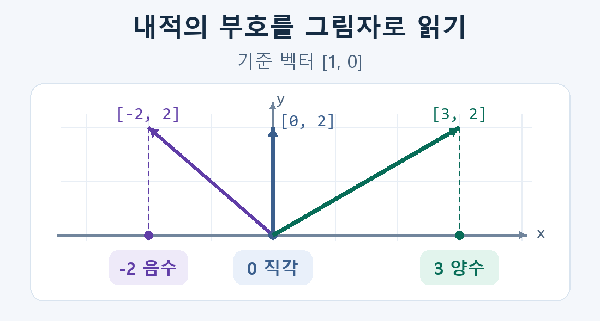
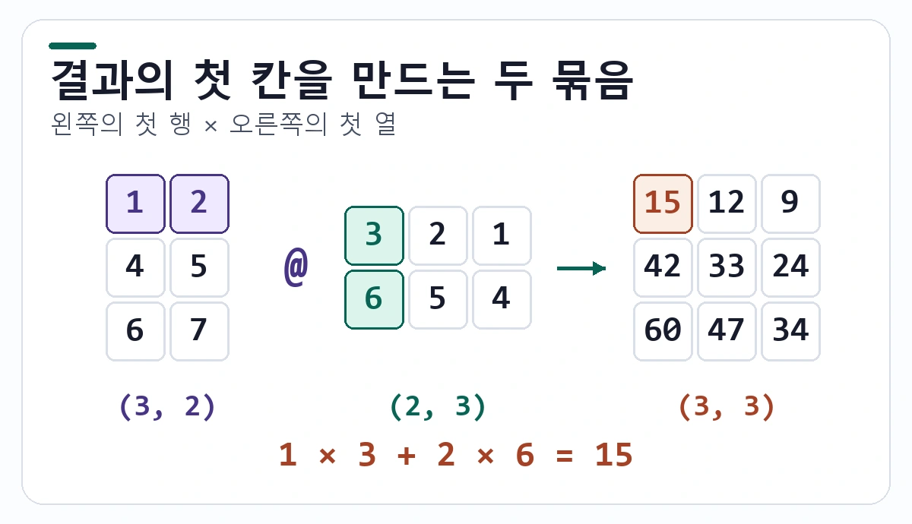
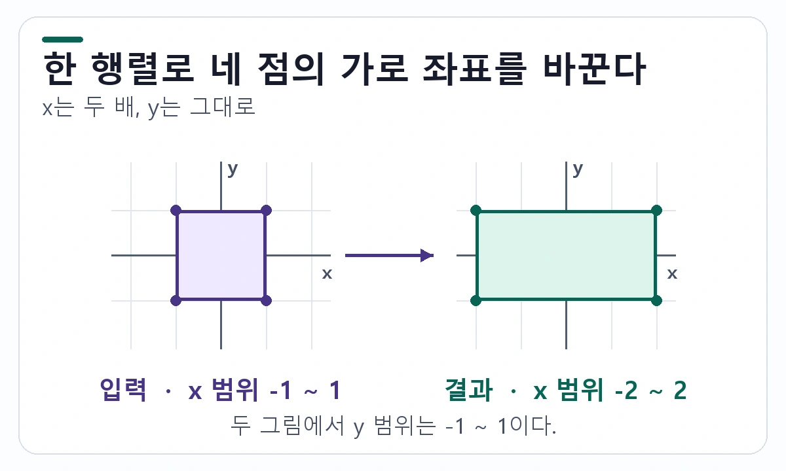
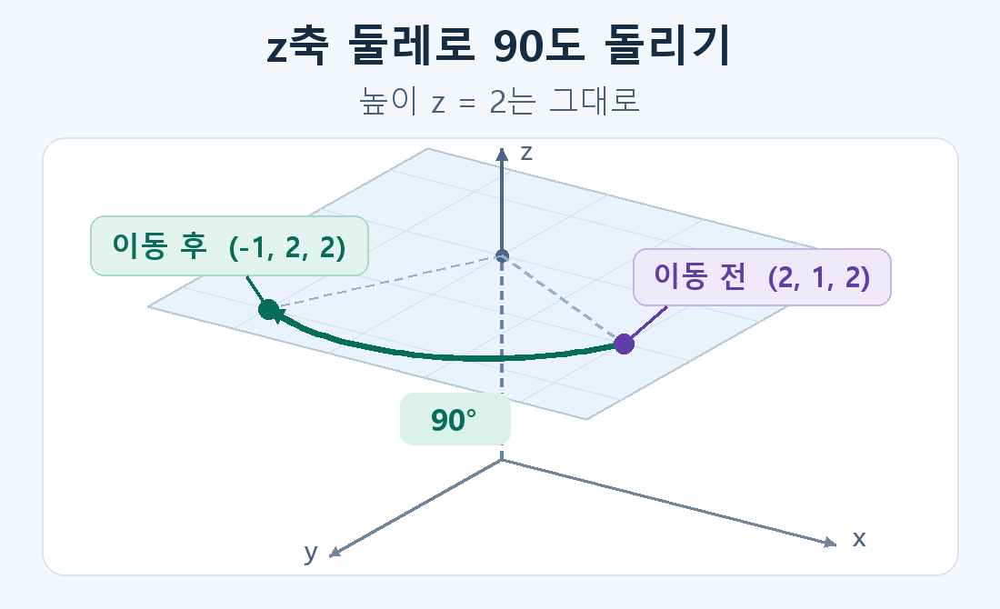

점 `(2, 1, 2)`를 `z`축 둘레로 90도 돌리면 `(-1, 2, 2)`로 이동한다. 새 좌표를 하나씩 계산하는 데 쓰는 연산은 두 벡터의 내적이다. 숫자가 세 개씩 든 배열에서 내적을 구하고, 같은 계산으로 행렬곱의 한 칸을 채워 보자.

## 내적은 대응하는 값을 곱한 뒤 하나로 더한다

`[1, 2, 3]`과 `[4, 5, 6]`을 `*`로 곱하면 세 칸에 각각 `4`, `10`, `18`이 남는다. 이 세 값을 모두 더해 `32`라는 숫자 하나를 얻는 계산을 **내적**이라고 한다. 두 입력이 같은 길이의 1차원 실수 또는 정수 배열이면 `a @ b`와 `np.dot(a, b)`로 같은 내적을 구할 수 있다. [NumPy `dot`](https://numpy.org/doc/2.4/reference/generated/numpy.dot.html) · [NumPy `matmul`](https://numpy.org/doc/2.4/reference/generated/numpy.matmul.html)

```python
import numpy as np

a = np.array([1, 2, 3])
b = np.array([4, 5, 6])

print(a * b)
print(a @ b)
print(np.dot(a, b))
```

```output
[ 4 10 18]
32
32
```

두 숫자를 좌표로 읽으면 내적의 부호에도 의미가 있다. 화살표 `[3, 2]`는 원점에서 오른쪽으로 `3`, 위로 `2`만큼 간다. 이 화살표 끝에서 x축에 수직선을 내리면 `3`에 닿는다. 기준선에 수직으로 내려 닿은 점이 끝점의 **정사영**이다. 여기서 그림자 길이는 원점에서 그 점까지 기준선을 따라 잰 길이다. 기준 방향의 반대쪽에 닿으면 길이에 음수 부호를 붙인다.



오른쪽을 가리키는 길이 `1`의 기준 벡터는 `[1, 0]`이다. `[3, 2] @ [1, 0]`은 `3 × 1 + 2 × 0 = 3`이다. 위쪽으로만 가는 `[0, 2]`는 그림자가 원점에 닿으므로 내적이 `0`이다. 왼쪽 위로 가는 `[-2, 2]`의 그림자는 원점 왼쪽에 닿아 `-2`가 된다. 기준 벡터의 방향을 그대로 두고 길이만 두 배로 늘린 `[2, 0]`을 쓰면 그림자 위치는 그대로이고 첫 내적은 `6`이 된다.

```python
import numpy as np

arrows = np.array([[3, 2], [0, 2], [-2, 2]])
x_unit = np.array([1, 0])
print(arrows @ x_unit)
print(arrows[0] @ np.array([2, 0]))
```

```output
[ 3  0 -2]
6
```

x축을 기준으로 삼으면 `y`에 `0`을 곱한다. 기준이 비스듬하면 `x`와 `y`가 함께 계산에 들어간다. 어느 쪽이든 기준선에 수직으로 내린 그림자라는 해석은 같다. 두 벡터의 길이가 모두 `0`보다 클 때, 사이 각도가 직각보다 작으면 내적은 양수, 직각이면 `0`, 직각보다 크면 음수다. 내적을 기준 벡터의 길이로 나누면 부호 있는 그림자 길이를 얻는다. 길이가 `1`인 기준 벡터를 쓰면 내적이 곧 그 길이다.

**직접 확인해 보기.** 내적 값에는 각도와 벡터의 길이가 함께 영향을 준다. `[3, 2]`와 `[6, 4]`를 각각 `[1, 0]`과 내적하면 `3`과 `6`이 나온다. 두 화살표의 방향은 같고, 길이가 두 배인 화살표의 내적도 두 배다.

같은 계산으로 항목마다 중요도가 다른 점수도 만들 수 있다. 과일의 단맛과 신맛에 각각 `3`, `2`를 주고, 단맛을 좋아하고 신맛을 덜 좋아하는 사람의 선호를 `[2, -1]`로 표현하면 점수는 `3 × 2 + 2 × (-1) = 4`다. 각 성분에 곱하는 숫자를 **가중치**라고 한다. 음수 가중치를 준 항목은 그 항목의 값이 클수록 합계에서 더 많이 빠진다.

## 행렬곱의 한 칸은 왼쪽 한 행과 오른쪽 한 열의 내적이다

같은 `(2, 2)` 모양의 두 배열로 `*`와 `@`의 왼쪽 위 칸을 비교해 보자. `left * right`는 두 표의 왼쪽 위에 있는 `1`과 `5`를 곱해 `5`를 만든다. `left @ right`는 왼쪽의 첫 행 `[1, 2]`와 오른쪽의 첫 열 `[5, 7]`을 꺼낸다. 두 벡터의 내적 `1 × 5 + 2 × 7`은 `19`다.

```python
import numpy as np

left = np.array([[1, 2], [3, 4]])
right = np.array([[5, 6], [7, 8]])
print(left * right)
print(left @ right)
```

```output
[[ 5 12]
 [21 32]]
[[19 22]
 [43 50]]
```

2차원 배열의 행렬곱에서는 짝지을 수 있도록 왼쪽의 **열 수**와 오른쪽의 **행 수**가 같아야 한다. 모양을 `(행 수, 열 수)`로 두 개 적으면 안쪽 두 숫자다. 결과의 행 수는 왼쪽에서 가져오고 열 수는 오른쪽에서 가져온다. 아래에서 `(3, 2) @ (2, 3)`은 안쪽의 `2`가 맞아서 결과가 `(3, 3)`이다. 각 칸에서 곱하는 항목도 두 쌍씩이다.



그림의 첫 칸은 `1 × 3 + 2 × 6 = 15`다. 이번에는 결과의 두 번째 행 세 번째 열을 손으로 구해 보자. 결과의 행 번호로 왼쪽 행 `[4, 5]`를, 열 번호로 오른쪽 열 `[1, 4]`를 고른다. `4 × 1 + 5 × 4 = 24`다. 오른쪽 열만 바꿔 고르면 결과는 같은 행의 다른 열에 들어간다.

```python
import numpy as np

m = np.array([[1, 2], [4, 5], [6, 7]])
n = np.array([[3, 2, 1], [6, 5, 4]])
print(m @ n)
print(n @ m)
try:
    print(m * n)
except ValueError as error:
    print(f"ValueError: {error}".rstrip())
```

```output
[[15 12  9]
 [42 33 24]
 [60 47 34]]
[[17 23]
 [50 65]]
ValueError: operands could not be broadcast together with shapes (3,2) (2,3)
```

순서를 바꾼 `n @ m`은 `(2, 3) @ (3, 2)`다. 안쪽의 `3`이 맞아 곱셈은 되고 결과는 `(2, 2)`로 바뀐다. 첫 칸에 이제 `3 × 1 + 2 × 4 + 1 × 6 = 17`이 들어간다. 같은 입력을 `*`로 곱하면 3편의 브로드캐스팅 규칙을 따른다. 오른쪽 축의 길이 `2`와 `3`이 맞지 않아 이 예에서는 `ValueError`가 난다. [NumPy `matmul`](https://numpy.org/doc/2.4/reference/generated/numpy.matmul.html)

### 한 열의 모양을 남길지 정한다

`[[1, 2, 3], [4, 5, 6]]`에서 각 행을 `[3, 4, 5]`와 내적하면 숫자 두 개를 얻는다. 첫 행은 `1 × 3 + 2 × 4 + 3 × 5 = 26`, 둘째 행은 `4 × 3 + 5 × 4 + 6 × 5 = 62`다. 오른쪽 입력을 1차원으로 주면 결과도 1차원이다. 같은 숫자를 모양 `(3, 1)`인 한 열에 넣으면 결과에도 열 축이 남는다.

```python
import numpy as np

rows = np.array([[1, 2, 3], [4, 5, 6]])
vector = np.array([3, 4, 5])
column = vector.reshape(3, 1)

flat_result = rows @ vector
column_result = rows @ column
print(flat_result, flat_result.shape)
print(column_result, column_result.shape, sep="\n")
```

```output
[26 62] (2,)
[[26]
 [62]]
(2, 1)
```

`rows @ column`은 `(2, 3) @ (3, 1)`이므로 안쪽의 `3`이 맞는다. `column @ rows`는 `(3, 1) @ (2, 3)`이므로 안쪽의 `1`과 `2`가 맞지 않는다. 두 방향을 각각 적어 보면 순서를 바꿔도 곱할 수 있는지 판단할 수 있다.

### 크기가 다른 두 문제를 손으로 풀어 본다

첫 문제는 `a`의 두 번째 행 `[3, 5, 4]`와 `b`의 두 번째 열 `[2, 4, 6]`을 골라 보자. 결과의 두 번째 행 두 번째 열은 `3 × 2 + 5 × 4 + 4 × 6 = 50`이다. 두 번째 문제에서는 `(4, 2) @ (2, 4)`이므로 결과가 `(4, 4)`다. 오른쪽 아래 칸은 `[7, 8]`과 `[7, 8]`에서 `7 × 7 + 8 × 8 = 113`이 된다. 손으로 답을 적은 뒤 배열의 해당 위치에서 확인한다.

```python
import numpy as np

a = np.array([[5, 4, 6], [3, 5, 4], [1, 2, 3]])
b = np.array([[1, 2], [3, 4], [5, 6]])
print(a @ b)

p = np.arange(1, 9).reshape(4, 2)
q = np.array([[1, 3, 5, 7], [2, 4, 6, 8]])
print(p @ q)
```

```output
[[47 62]
 [38 50]
 [22 28]]
[[  5  11  17  23]
 [ 11  25  39  53]
 [ 17  39  61  83]
 [ 23  53  83 113]]
```

## 오른쪽 행렬의 열마다 새 좌표 하나를 정한다

여러 점을 계산할 때는 각 행에 점 하나를 넣는다. 두 열이 있는 표에서 첫 열은 `x`, 둘째 열은 `y`다. 오른쪽에 곱할 행렬의 첫 열은 결과의 `x`를, 둘째 열은 결과의 `y`를 계산하는 규칙이다. 예를 들어 첫 열을 `[2, 0]`, 둘째 열을 `[0, 1]`로 주면 `[x, y]`와 내적한 값은 각각 `2x`, `y`다. 점 네 개에 같은 행렬을 곱하면 가로 길이만 두 배가 된다.



### 평면에서 점을 90도 돌린다

`[x, y]`를 원점 둘레에서 반시계 방향으로 90도 돌리면 `[-y, x]`가 된다. `(1, 0)`은 위쪽의 `(0, 1)`로, `(0, 1)`은 왼쪽의 `(-1, 0)`으로 이동한다. 이 이동을 행렬로 표현하려면 새 `x`를 만드는 첫 열을 `[0, -1]`로 두고, 새 `y`를 만드는 둘째 열을 `[1, 0]`으로 둔다. 아래에서 점 `(1, 1)`은 첫 번째 열과 내적해 `-1`, 두 번째 열과 내적해 `1`을 얻는다.

```python
import numpy as np

points = np.array([[1, 1], [-1, 1], [-1, -1], [1, -1]])
scale = np.array([[2, 0], [0, 1]])
turn = np.array([[0, 1], [-1, 0]])

print((points @ scale).tolist())
print((points @ turn).tolist())
print(points[0] @ scale @ turn, points[0] @ turn @ scale)
```

```output
[[2, 1], [-2, 1], [-2, -1], [2, -1]]
[[-1, 1], [-1, -1], [1, -1], [1, 1]]
[-1  2] [-2  1]
```

마지막 줄의 두 좌표는 변환 순서를 바꾼 결과다. `(1, 1)`을 먼저 가로로 늘리면 `(2, 1)`이고, 이어 돌리면 `(-1, 2)`다. 먼저 돌리면 `(-1, 1)`이고, 이어 가로로 늘리면 `(-2, 1)`이다. 두 동작에 같은 행렬을 쓰더라도 적용 순서에 따라 도착점이 달라질 수 있다.

### 3차원에서는 회전축에 해당하는 좌표를 유지한다

3차원 점을 한 행에 `[x, y, z]`로 담는다. `z`축 둘레에서 90도 회전하면 `x`와 `y`는 위와 같이 `[-y, x]`로 바뀌고, 높이 `z`는 그대로다. 회전 행렬의 세 번째 열 `[0, 0, 1]`이 이 높이를 꺼낸다. 첫 점 `(2, 1, 2)`는 결과의 `x`가 `-1`, `y`가 `2`가 되며 높이는 `2`다. 그림의 두 점은 같은 높이 평면 위에 놓여 있다.



```python
import numpy as np

points = np.array([[2, 1, 2], [0, 2, 1], [1, -1, 3]])
rotate_z = np.array([[0, 1, 0], [-1, 0, 0], [0, 0, 1]])
turned = points @ rotate_z

by_loop = []
for x, y, z in points:
    by_loop.append([-y, x, z])

print(turned)
print(turned.shape)
print(np.array_equal(turned, np.array(by_loop)))
```

```output
[[-1  2  2]
 [-2  0  1]
 [ 1  1  3]]
(3, 3)
True
```

`points`는 세 좌표가 필요해서 3차원 공간의 점을 표현한다. 배열에는 점을 세는 행 축과 좌표를 세는 열 축만 있으므로 배열 자체는 2차원이다. `(3, 3) @ (3, 3)`에서 왼쪽의 바깥쪽 `3`은 점의 수이고, 오른쪽의 바깥쪽 `3`은 점마다 새로 계산할 좌표의 수다. 점이 다섯 개면 입력 `(5, 3)`에 같은 `(3, 3)`을 곱해 `(5, 3)`을 얻는다.

반복문은 한 행씩 `[-y, x, z]`를 만들고, 행렬곱은 같은 좌표 계산을 입력의 모든 행에 표현한다. `True`는 두 결과의 모양과 값이 같다는 뜻이다. 일반적인 행렬곱에서 NumPy는 가능한 경우 최적화된 선형대수 라이브러리를 사용한다. 어느 쪽이 빠른지는 배열의 크기와 자료형, 실행 환경에 따라 달라진다. [NumPy `matmul`](https://numpy.org/doc/2.4/reference/generated/numpy.matmul.html)

행렬곱의 서로 다른 결과 칸은 값을 읽고 독립적으로 계산할 수 있다. CPU나 GPU에서 여러 칸을 나눠 계산하는 데 활용하는 성질이다. 위 예제의 `points.device`는 `'cpu'`다. Colab에서 GPU 런타임을 선택해도 일반 NumPy 배열은 CPU에서 계산한다. [NumPy 배열 생성과 `device`](https://numpy.org/doc/2.4/reference/generated/numpy.zeros.html)

### 각도와 회전축을 바꿔 본다

30도처럼 다른 각도로 돌리려면 `np.radians`로 각도를 라디안으로 바꾼 다음 `np.cos`와 `np.sin`에 넣는다. 라디안은 도와 같은 각을 다른 단위로 적는 방식이다. 아래 코드에서 각각 `c`와 `s`로 계산하면 새 `x`는 `x × c - y × s`, 새 `y`는 `x × s + y × c`다. 90도에서는 수학적으로 `c = 0`, `s = 1`이라 위에서 손으로 구한 `[-y, x, z]`와 이어진다. [NumPy `radians`](https://numpy.org/doc/2.4/reference/generated/numpy.radians.html)

```python
import numpy as np

point = np.array([2, 1, 2])
theta = np.radians(30)
c, s = np.cos(theta), np.sin(theta)
rotate_z = np.array([[c, s, 0], [-s, c, 0], [0, 0, 1]])
print(np.round(point @ rotate_z, 3))
```

```output
[1.232 1.866 2.   ]
```

회전축을 바꾸면 어느 값을 남길지도 바뀐다. 오른손 엄지를 축의 양의 방향으로 향하게 했을 때, 나머지 손가락이 감기는 쪽을 양의 회전으로 정한다. 이 기준에서 90도 회전은 다음과 같다.

| 회전축 | 유지되는 좌표 | `[x, y, z]`의 새 좌표 |
|---|---|---|
| `x`축 | `x` | `[x, -z, y]` |
| `y`축 | `y` | `[z, y, -x]` |
| `z`축 | `z` | `[-y, x, z]` |

**직접 확인해 보기.** `(2, 1, 2)`를 `y`축 둘레에서 90도 돌려 보자. 새 `x`는 원래 `z`인 `2`, 새 `y`는 원래 `y`인 `1`, 새 `z`는 원래 `x`의 부호를 바꾼 `-2`다. `z`, `y`, `-x`를 차례로 꺼내는 열을 적으면 `[0, 0, 1]`, `[0, 1, 0]`, `[-1, 0, 0]`이다. NumPy에서는 행을 한 줄씩 적어 `np.array([[0, 0, -1], [0, 1, 0], [1, 0, 0]])`을 만든 뒤 점 배열의 오른쪽에 곱한다.
