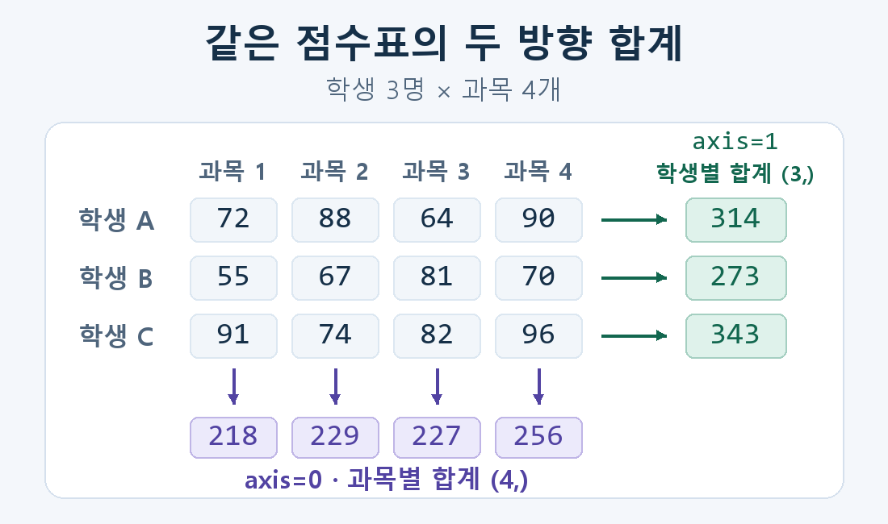
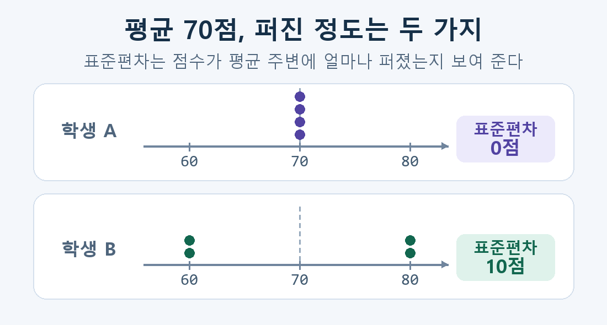
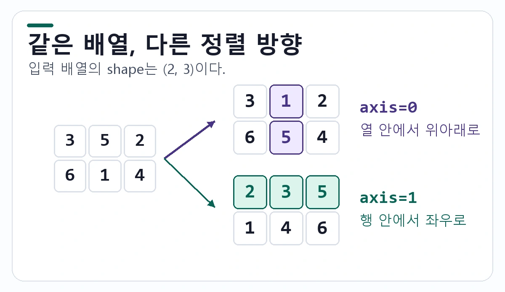

학생 세 명이 과목 네 개를 치른 점수표에서 과목별 합계는 네 개이고, 학생별 합계는 세 개다. 같은 표를 축에 따라 정렬하면 점수 열두 개가 자리를 바꾼다. 어떤 값이 같은 묶음에서 계산되는지 읽고, 집계와 정렬의 결과 모양을 예상해 보자.

## 집계는 지정한 축의 여러 값을 하나로 모은다

2편의 점수표에는 학생 세 명이 한 행씩, 과목 네 개가 한 열씩 들어 있다. `shape`는 `(3, 4)`다. 과목별 합계를 구하려면 같은 열의 학생 점수를 더한다. 학생별 합계를 구하려면 같은 행에 있는 네 과목 점수를 더한다. 여러 값을 하나의 합계나 평균으로 모으는 연산을 **집계**라고 한다.

`axis=0`에서 `0`은 행 번호가 바뀌는 축이다. 첫 과목에 해당하는 열에 머물면서 학생 세 명의 `72 + 55 + 91 = 218`을 구한다. 모든 열에 같은 계산을 하면 과목 수만큼 값이 남아 `(4,)`가 된다. `axis=1`은 열 번호가 바뀌는 축이다. 첫 학생의 행에 머물면서 `72 + 88 + 64 + 90 = 314`를 구한다. 학생마다 값 하나가 남으므로 결과는 `(3,)`다.



```python
import numpy as np

scores = np.array([[72, 88, 64, 90], [55, 67, 81, 70], [91, 74, 82, 96]])
by_subject = scores.sum(axis=0)
by_student = scores.sum(axis=1)

print(by_subject, by_subject.shape)
print(by_student, by_student.shape)
print(scores.sum())
```

```output
[218 229 227 256] (4,)
[314 273 343] (3,)
930
```

기본 설정에서 집계한 축은 결과 모양에서 빠진다. `(3, 4)`의 `0`번 축을 모으면 뒤의 `4`만, `1`번 축을 모으면 앞의 `3`만 남는다. `sum()`에서 `axis`를 생략하면 `axis=None`으로 처리해 두 축을 모두 합친다. 과목별 합계 네 개를 더해도, 학생별 합계 세 개를 더해도 전체 합계 `930`이 나온다. [NumPy `sum`](https://numpy.org/doc/2.4/reference/generated/numpy.sum.html)

### 다음 계산에 축이 필요하면 길이 1로 남긴다

학생마다 자기 평균보다 각 과목 점수가 몇 점 높은지 보려면, 평균을 해당 학생 행의 모든 칸에서 빼면 된다. `scores.mean(axis=1)`은 학생별 값 세 개를 주지만 모양이 `(3,)`이다. 그대로 `(3, 4)`에서 빼면 오른쪽 축의 `4`와 `3`이 맞지 않는다. `keepdims=True`는 집계한 열 축을 길이 `1`로 남긴다. 그러면 `(3, 1)`의 각 행에 평균이 하나씩 놓여, 3편에서 본 행별 브로드캐스팅이 가능하다. [NumPy `mean`](https://numpy.org/doc/2.4/reference/generated/numpy.mean.html)

```python
import numpy as np

scores = np.array([[72, 88, 64, 90], [55, 67, 81, 70], [91, 74, 82, 96]])
student_means = scores.mean(axis=1, keepdims=True)
print(student_means, student_means.shape, sep="\n")
print((scores - student_means)[0])
```

```output
[[78.5 ]
 [68.25]
 [85.75]]
(3, 1)
[ -6.5   9.5 -14.5  11.5]
```

첫 학생의 평균은 `314 ÷ 4 = 78.5`다. 첫 과목 `72`는 자기 평균보다 `6.5`점 낮고, 둘째 과목 `88`은 `9.5`점 높다. 오른쪽에 길이 `1`인 축을 남기면 각 학생의 평균을 그 행에만 적용할 수 있다.

## 평균이 같아도 점수의 퍼진 정도는 다르다

같은 점수표에서 무엇을 알고 싶은지 정하면 집계 함수를 고를 수 있다. 과목별 평균에는 그 과목의 점수가 모두 반영된다. 중앙값은 점수를 순서대로 놓았을 때 가운데가 어디인지 알려 준다. 최솟값과 최댓값은 양끝을, 표준편차는 점수가 평균 주변에 얼마나 퍼져 있는지를 보여 준다. `axis=0`으로 계산하면 어느 집계에서든 열마다 값 하나를 얻는다.

```python
import numpy as np

scores = np.array([[72, 88, 64, 90], [55, 67, 81, 70], [91, 74, 82, 96]])
print(np.round(scores.mean(axis=0), 2))
print(np.median(scores, axis=0))
print(scores.min(axis=0))
print(scores.max(axis=0))
print(np.round(scores.std(axis=0), 2))
```

```output
[72.67 76.33 75.67 85.33]
[72. 74. 81. 90.]
[55 67 64 70]
[91 88 82 96]
[14.7   8.73  8.26 11.12]
```

평균과 표준편차는 보기 좋게 소수 둘째 자리까지 반올림했다. 첫 과목의 점수는 `72`, `55`, `91`이다. 평균은 합계 `218`을 학생 수 `3`으로 나눈 약 `72.67`이다. 중앙값을 찾을 때는 오름차순으로 `55`, `72`, `91`을 놓고 가운데 `72`를 고른다. 최솟값은 `55`, 최댓값은 `91`이다.

개수가 짝수면 가운데 두 값의 평균을 중앙값으로 삼는다. 첫 학생의 네 과목을 정렬하면 `[64, 72, 88, 90]`이고, 가운데 두 점수의 평균은 `(72 + 88) ÷ 2 = 80`이다. 학생별 평균은 `scores.mean(axis=1)`처럼 배열의 메서드로 구할 수 있다. 학생별 중앙값은 `np.median(scores, axis=1)`처럼 NumPy 함수에 배열을 넘긴다. [NumPy `median`](https://numpy.org/doc/2.4/reference/generated/numpy.median.html)

첫 과목 최고 점수가 `91`에서 `100`으로 바뀌면 평균은 어떻게 달라질까? 점수 합계가 `9`만큼 커지므로 평균은 `3`만큼 올라 약 `75.67`이 된다. 정렬한 세 값의 가운데는 여전히 `72`여서 중앙값도 `72`다. 큰 값 하나가 바뀌면 평균이 바로 움직이고, 이 예제에서는 중앙값이 그대로다.

### 표준편차는 평균에서 떨어진 거리를 요약한다

다른 두 학생의 점수가 각각 `[70, 70, 70, 70]`과 `[60, 60, 80, 80]`이라면 평균은 둘 다 `70`이다. 첫 학생의 점수는 모두 평균과 같은 `70`이다. 둘째 학생의 점수는 평균에서 각각 `10`점씩 낮거나 높다. 표준편차는 이 차이를 한 숫자로 요약한다.



둘째 학생의 점수에서 평균을 빼면 `-10`, `-10`, `10`, `10`이다. 각 차이를 그대로 더하면 음수와 양수가 상쇄되므로 차이를 각각 제곱한다. 네 값이 모두 `100`이고 그 평균도 `100`이다. 이 평균을 **분산**이라고 한다. 여기에 제곱근을 적용하면 원래 점수와 같은 단위를 쓰는 표준편차 `10`을 얻는다.

```python
import numpy as np

practice = np.array([[70, 70, 70, 70], [60, 60, 80, 80]])
print(practice.mean(axis=1))
print(practice.std(axis=1))
```

```output
[70. 70.]
[ 0. 10.]
```

NumPy의 기본값은 `ddof=0`이다. 점수 네 개라면 제곱한 차이의 합을 `4`로 나눈다. 더 큰 집단에서 뽑은 표본으로 표준편차를 계산할 때 흔히 쓰는 `ddof=1`은 분모를 `4 - 1`로 바꾼다. `practice.std(axis=1, ddof=1)`로 바꾸면 둘째 학생의 결과는 약 `11.55`다. 두 결과를 비교할 때는 어떤 분모로 계산했는지 먼저 확인한다. [NumPy `std`](https://numpy.org/doc/2.4/reference/generated/numpy.std.html)

**직접 확인해 보기.** `scores.std(axis=0)`을 `scores.std(axis=1)`로 바꾸면 학생 세 명의 과목 간 점수 차이를 요약한다. 세 값은 각각 약 `10.90`, `9.26`, `8.44`다. 표준편차의 값만 비교하기 전에 같은 과목에서 학생들 간 점수를 본 것인지, 한 학생이 받은 여러 과목 점수를 본 것인지 확인한다.

## 정렬은 축 안에서 순서를 바꾸고 `argsort`는 위치를 찾는다

같은 점수표를 `axis=0`으로 집계하면 열마다 한 값이 남는다. 같은 축을 따라 정렬하면 열 안의 점수가 위아래로 재배치되어 `(3, 4)`가 유지된다. `axis=1`로 정렬하면 행 안의 점수를 왼쪽부터 오름차순으로 놓는다. 그림의 작은 표에서도 열별 정렬은 세로로, 행별 정렬은 가로로 값이 이동한다.



```python
import numpy as np

scores = np.array([[72, 88, 64, 90], [55, 67, 81, 70], [91, 74, 82, 96]])
print(np.sort(scores, axis=0))
print(np.sort(scores, axis=1))
print(np.sort(scores, axis=None))
```

```output
[[55 67 64 70]
 [72 74 81 90]
 [91 88 82 96]]
[[64 72 88 90]
 [55 67 70 81]
 [74 82 91 96]]
[55 64 67 70 72 74 81 82 88 90 91 96]
```

`axis=0`에서 둘째 과목의 `88`, `67`, `74`는 위에서 아래로 `67`, `74`, `88`이 된다. 과목마다 따로 정렬하므로 출력의 한 행에 여러 학생의 점수가 섞일 수 있다. `axis=1`에서는 첫 학생의 `72`, `88`, `64`, `90`을 `64`, `72`, `88`, `90`으로 정리한다. `np.sort()`에서 `axis`의 기본값은 마지막 축인 `-1`이다. 2차원에서는 `axis=1`과 같다. `axis=None`을 직접 주면 모든 칸을 한 줄에 모아 정렬하므로 결과는 `(12,)`다. [NumPy `sort`](https://numpy.org/doc/2.4/reference/generated/numpy.sort.html)

### 원본을 바꿀지, 정렬 순서를 따로 구할지 고른다

| 호출 | 돌아오는 값 | 원래 배열 |
|---|---|---|
| `np.sort(first)` | 정렬한 값의 복사본 | 순서를 유지한다. |
| `first.sort()` | `None` | 정렬한 순서로 바뀐다. |
| `np.argsort(first)` | 정렬할 때 값을 꺼낼 위치 | 순서를 유지한다. |

아래에서 `first`는 첫 과목의 원래 점수 `[72, 55, 91]`이다. `np.sort(first)`를 호출한 뒤에도 `first`를 읽으면 같은 순서다. 이어서 `first.sort()`를 호출하면 돌아오는 값은 `None`이고, 그다음에 `first`를 읽으면 점수가 정렬되어 있다. `first = first.sort()`라고 쓰면 원래 배열을 가리키던 이름에 `None`이 들어간다. 바뀐 배열을 계속 쓰려면 메서드를 호출한 다음 `first`를 읽는다. [NumPy `ndarray.sort`](https://numpy.org/doc/2.4/reference/generated/numpy.ndarray.sort.html)

```python
import numpy as np

first = np.array([72, 55, 91])
print(np.sort(first))
print(first)
print(first.sort())
print(first)
```

```output
[55 72 91]
[72 55 91]
None
[55 72 91]
```

학생의 행 전체를 첫 과목 점수순으로 재배열하려면 점수를 정렬할 **위치 순서**를 먼저 구한다. 아래에서는 마지막 학생의 첫 과목 점수를 `72`로 두어 첫 학생과 동점을 만들었다. `np.argsort(scores[:, 0], stable=True)`가 반환하는 `[1, 0, 2]`는 `55`점인 `1`번 학생을 먼저, `72`점인 `0`번과 `2`번 학생을 그다음에 가져오라는 뜻이다. `stable=True`를 주면 같은 점수는 입력에 있던 순서를 유지한다. [NumPy `argsort`](https://numpy.org/doc/2.4/reference/generated/numpy.argsort.html)

```python
import numpy as np

scores = np.array([[72, 88, 64, 90], [55, 67, 81, 70], [72, 74, 82, 96]])
names = np.array(["A", "B", "C"])
order = np.argsort(scores[:, 0], stable=True)

print(order)
print(names[order].tolist())
print(scores[order])
```

```output
[1 0 2]
['B', 'A', 'C']
[[55 67 81 70]
 [72 88 64 90]
 [72 74 82 96]]
```

`names[order]`와 `scores[order]`에 같은 위치 목록을 썼으므로 학생 이름과 네 과목 점수의 짝이 유지된다. 2편에서 번호 목록으로 행을 골랐던 것과 같은 방식이다. 온전한 행이 필요한 경우에는 어느 열로 순서를 정하고 어떤 배열에 그 순서를 적용할지 생각해 보면 된다.

**직접 확인해 보기.** 이번에는 각 학생의 과목 순서를 구해 보자. `order_by_subject = np.argsort(scores, axis=1)`은 행마다 열 번호의 새 순서를 구한다. 첫 학생의 행은 `[72, 88, 64, 90]`이다. 작은 값부터 읽으면 열 번호는 `[2, 0, 1, 3]`이 된다. `np.take_along_axis(scores, order_by_subject, axis=1)`은 각 행에서 자기 열 순서대로 값을 꺼낸다. 첫 학생의 결과는 `[64, 72, 88, 90]`이다. [NumPy `take_along_axis`](https://numpy.org/doc/2.4/reference/generated/numpy.take_along_axis.html)

배열 연산을 시작할 때는 `shape`가 설명하는 각 축의 의미를 먼저 읽는다. 인덱싱에서 축은 위치를 고르는 자리였고, 브로드캐스팅에서는 오른쪽부터 길이를 비교하는 자리였다. 행렬곱은 왼쪽 열과 오른쪽 행을 짝짓는다. 집계와 정렬에서는 적용할 방향을 먼저 확인하고, 그 연산이 축을 한 값으로 모으는지 값의 순서를 바꾸는지 살핀다.
