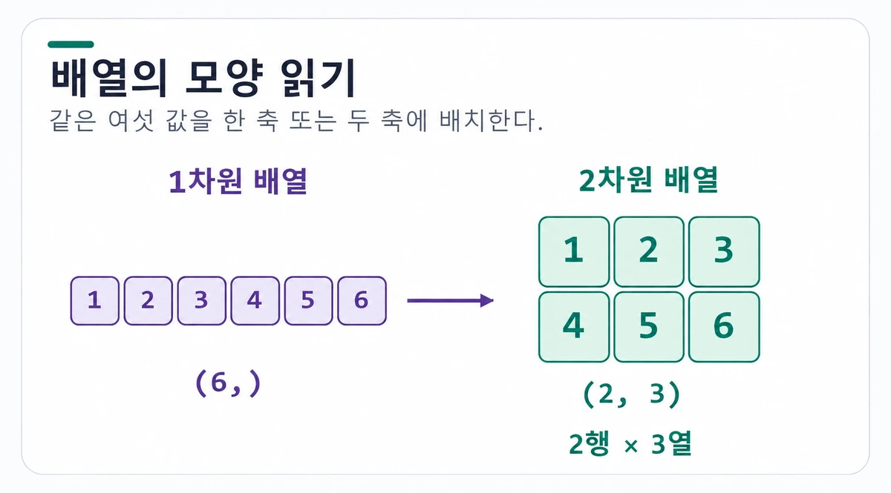

## 같은 여섯 값도 배치에 따라 모양이 달라진다

숫자 1부터 6까지 한 줄로 놓으면, 값 `5`를 찾는 데 줄 안의 위치 하나면 충분하다. 같은 숫자를 세 개씩 두 줄로 놓으면, `5`가 어느 행의 어느 열에 있는지 찾아야 한다. 값을 찾을 때 위치를 지정하는 방향 하나를 **축**이라고 한다.



NumPy에서는 리스트를 `np.array()`에 넘겨 배열을 만든다. 안쪽 리스트 두 개를 담으면 각각 한 행이 된다. 아래 코드는 두 배열을 만들고, `shape`로 축마다 길이를 확인하는 예시다. Python 실행 환경이 없다면 Colab에서 노트북을 열어 코드 셀에 입력하고 실행한다. [Google Colab](https://colab.research.google.com/)

```python
import numpy as np

line = np.array([1, 2, 3, 4, 5, 6])
grid = np.array([[1, 2, 3], [4, 5, 6]])

print(line.shape)
print(grid.shape)
```

```output
(6,)
(2, 3)
```

`(6,)`은 길이가 6인 축이 하나 있다는 뜻이다. 쉼표는 길이 하나를 담은 튜플임을 표시한다. `(2, 3)`에서 첫 번째 길이 `2`는 행의 수이고, 두 번째 길이 `3`은 열의 수다.

## 축의 개수와 길이, 전체 원소 수를 구분한다

배열에 값이 여섯 개 있다는 사실만으로는 한 줄인지 2행 3열인지 알 수 없다. NumPy는 축의 개수를 `ndim`, 축별 길이를 `shape`, 전체 원소 수를 `size`에 담는다. 아래 코드는 숫자 하나만 담은 배열과 앞에서 만든 두 배열의 세 속성을 비교하는 예시다.

```python
import numpy as np

scalar = np.array(5)
line = np.array([1, 2, 3, 4, 5, 6])
grid = np.array([[1, 2, 3], [4, 5, 6]])

print("scalar", scalar.ndim, scalar.shape, scalar.size)
print("line", line.ndim, line.shape, line.size)
print("grid", grid.ndim, grid.shape, grid.size)
```

```output
scalar 0 () 1
line 1 (6,) 6
grid 2 (2, 3) 6
```

| 배열 | 축의 개수 `ndim` | 축별 길이 `shape` | 전체 원소 수 `size` |
|---|---:|---|---:|
| `scalar` | 0 | `()` | 1 |
| `line` | 1 | `(6,)` | 6 |
| `grid` | 2 | `(2, 3)` | 6 |

`line`과 `grid`는 축의 개수와 길이가 다르지만 원소 수는 둘 다 `6`이다. `grid`에는 한 행에 값이 세 개씩 있고 행이 두 개이므로 전체 원소 수는 `2 × 3 = 6`이다.

숫자 `5`처럼 값 하나를 **스칼라**라고 한다. `np.array(5)`는 스칼라를 담은 0차원 배열이다. 길이를 적을 축이 없어서 `shape`는 `()`이고, 안에 값이 하나 있으므로 `size`는 `1`이다. [NumPy 배열 속성](https://numpy.org/doc/2.4/user/absolute_beginners.html#array-attributes)

## 같은 세 값도 한 줄·한 행·한 열의 모양이 다르다

`[1, 2, 3]`은 값 세 개를 한 줄에 담는다. `[[1, 2, 3]]`은 안쪽 리스트 하나에 세 값을 담으므로 1행 3열 배열이 된다. `[[1], [2], [3]]`은 값마다 안쪽 리스트가 하나씩 있어 3행 1열 배열이 된다.

아래 코드는 세 배열의 모양과 값 `2`가 있는 위치를 비교하는 예시다. 대괄호 안의 위치 번호는 `0`부터 센다. 2차원 배열에서는 행 번호와 열 번호를 쉼표로 구분한다.

```python
import numpy as np

line = np.array([1, 2, 3])
one_row = np.array([[1, 2, 3]])
one_col = np.array([[1], [2], [3]])

print(line.shape, line[1])
print(one_row.shape, one_row[0, 1])
print(one_col.shape, one_col[1, 0])
```

```output
(3,) 2
(1, 3) 2
(3, 1) 2
```

`line[1]`은 한 줄 안에서 두 번째 값이다. `one_row[0, 1]`은 첫 행의 두 번째 열이고, `one_col[1, 0]`은 두 번째 행의 첫 열이다. 값은 모두 `2`지만, 모양에 따라 위치를 읽는 방법이 달라진다.

## 3차원 배열의 모양은 표·행·열 순서로 읽는다

앞에서 본 2차원 배열을 표 한 장이라고 생각하면, 같은 크기의 표를 여러 장 쌓은 배열에는 표 번호를 지정하는 축이 하나 더 생긴다. 이 예제에서 `(2, 3, 4)`는 표 두 장, 표마다 세 행, 행마다 네 열을 뜻한다.

아래 코드는 `np.zeros()`로 두 표를 0으로 채운 뒤, 배열 전체와 첫 번째 표의 모양을 출력하는 예시다. `dtype=int`는 0을 정수로 저장한다는 뜻이다.

```python
import numpy as np

pages = np.zeros((2, 3, 4), dtype=int)
first_page = pages[0]

print(pages.shape)
print(first_page)
print(first_page.shape)
```

```output
(2, 3, 4)
[[0 0 0 0]
 [0 0 0 0]
 [0 0 0 0]]
(3, 4)
```

`pages[0]`에서 `0`은 첫 번째 표의 위치다. 표 한 장을 고르면 그 안의 행과 열이 남는다. 출력도 세 줄에 값이 네 개씩 놓여 있어 `(3, 4)`가 뜻하는 모양을 확인할 수 있다. [NumPy 인덱싱](https://numpy.org/doc/2.4/user/basics.indexing.html#single-element-indexing)

## 모양을 정해 배열을 만들고 출력으로 확인한다

처음 비교한 2행 3열 배열은 리스트에 값을 하나씩 적어 만들었다. 같은 모양을 0으로 채우려면 `np.zeros()`에 축별 길이 `(2, 3)`을 주면 된다. 아래 코드는 그 순서를 `(3, 2)`로 바꿔 만든 배열과 비교하는 예시다.

```python
import numpy as np

wide = np.zeros((2, 3), dtype=int)
tall = np.zeros((3, 2), dtype=int)

print(wide)
print(wide.shape, wide.size)
print(tall)
print(tall.shape, tall.size)
```

```output
[[0 0 0]
 [0 0 0]]
(2, 3) 6
[[0 0]
 [0 0]
 [0 0]]
(3, 2) 6
```

`wide`는 두 행에 세 칸씩, `tall`은 세 행에 두 칸씩 갖는다. 앞의 숫자가 행의 수이고 뒤의 숫자가 열의 수다. 두 배열 모두 전체 칸 수는 `6`이다. [NumPy.zeros](https://numpy.org/doc/2.4/reference/generated/numpy.zeros.html)

**직접 확인해 보기.** `np.zeros((3, 2), dtype=int)`의 모양을 `(1, 6)`으로 바꿔 실행한다. 한 행에 0이 여섯 개 놓이며, `shape`는 `(1, 6)`, `size`는 `6`이 된다.

배열에서 행과 열이 각각 어디에 놓이는지 알면 원하는 위치를 지정할 수 있다. 위치나 조건으로 값을 고르는 방법은 2편에서 다룬다. [NumPy 2편](/blog/python-numpy-indexing/)